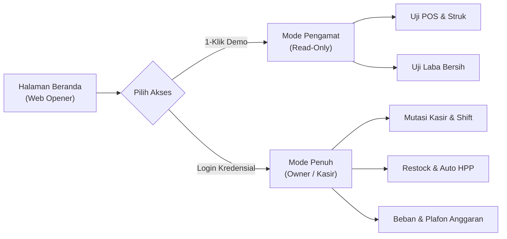
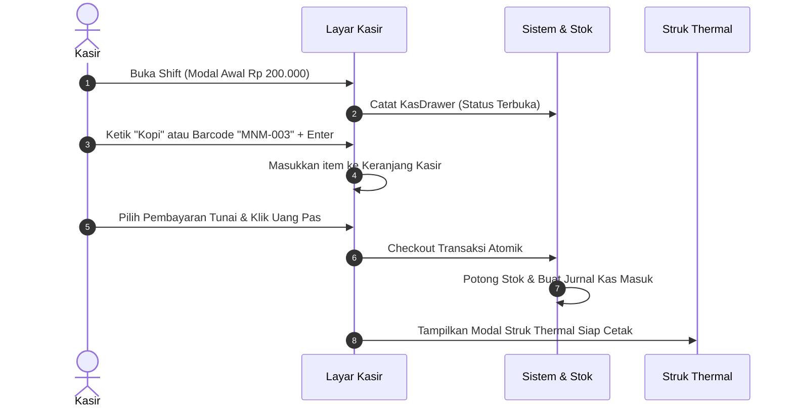

# 📋 Panduan Uji Coba & Skenario Pengujian (Testing Guide)
## Aplikasi Keuangan UMKM — Sistem Kasir (POS) & Manajemen Keuangan Terpadu

> **Alamat URL Aplikasi:** [https://aplikasikeuanganumkm.web.id](https://aplikasikeuanganumkm.web.id)  
> **Repositori Sumber Terbuka:** [GitHub - bipisurel-bps/aplikasikeuanganumkmgratis](https://github.com/bipisurel-bps/aplikasikeuanganumkmgratis)  
> **Lisensi:** MIT License · Dikembangkan oleh **bipi (jaddadeveloper)**

---

## 🎯 Tujuan Pengujian

Panduan ini disusun untuk memandu evaluator, pemilik usaha, kasir, maupun pengembang dalam memvalidasi seluruh alur bisnis aplikasi secara terstruktur, mulai dari meja kasir depan hingga laporan akuntansi laba bersih riil di meja pemilik.

---

## 🔑 Kredensial & Akses Cepat

Tersedia dua metode untuk mengakses aplikasi:

### 1. Masuk Instan (1-Klik Tanpa Kata Sandi)
Buka [https://aplikasikeuanganumkm.web.id/masuk](https://aplikasikeuanganumkm.web.id/masuk) atau klik tombol di bagian bawah landing page:
- Klik **"Mode Pemilik (Demo)"** &rarr; Langsung diarahkan ke Dashboard Keuangan.
- Klik **"Mode Kasir (Demo)"** &rarr; Langsung diarahkan ke Layar Kasir (POS).

### 2. Masuk Manual dengan Akun Bawaan

| Peran Akun | Alamat Email | Kata Sandi | Cakupan Otoritas |
| :--- | :--- | :--- | :--- |
| **Pemilik (Owner)** | `owner@umkm.test` | `password` | Seluruh dashboard keuangan, laba kotor & bersih, kontrol plafon anggaran, katalog produk, restock HPP, supplier, buku kas |
| **Kasir Toko** | `kasir@umkm.test` | `password` | Layar kasir (POS), pemindaian barcode SKU, cetak nota struk belanja, buka/tutup shift kasir, riwayat penjualan shift |

---

## 🧪 Skenario Pengujian Langkah-demi-Langkah

---

### Skenario 1: Eksplorasi Halaman Depan & Tampilan Mobile

**Tujuan:** Memastikan halaman pembuka (*web opener*) informatif, responsif di HP/tablet, dan navigasi berfungsi mulus.

| Langkah | Aksi | Hasil yang Diharapkan |
| :---: | :--- | :--- |
| 1.1 | Buka [https://aplikasikeuanganumkm.web.id](https://aplikasikeuanganumkm.web.id) di browser ponsel atau aktifkan *Device Mode* (layar 360px - 414px) di browser laptop. | Halaman tampil rapi tanpa geseran horizontal (*no horizontal overflow*), header proporsional, teks judul tidak terpotong ganjil. |
| 1.2 | Periksa tombol pintasan di jendela pratinjau (*Showcase Window*): klik tab **"Dashboard Laba"** dan tab **"Layar Kasir"**. | Konten pratinjau berganti secara mulus via Alpine.js tanpa muat ulang halaman. |
| 1.3 | Geser ke bagian **Tabel Perbandingan Fitur**. | Muncul indikator "Geser tabel &rarr;" di mobile dan tabel dapat digeser horizontal dengan nyaman. |
| 1.4 | Klik tombol **"Hubungi via Email"** di hero atau form bantuan. | Aplikasi email bawaan terbuka dengan penerima terisi `jaddadeveloper@gmail.com` dan subjek otomatis. Tidak ada nomor WhatsApp yang tertampil. |

---

### Skenario 2: Alur Kerja Meja Kasir (Point of Sales)

**Tujuan:** Menguji kecepatan pelayanan transaksi kasir, kalkulasi kembalian, pemotongan stok otomatis, dan pencetakan nota.

| Langkah | Aksi | Hasil yang Diharapkan |
| :---: | :--- | :--- |
| 2.1 | Masuk sebagai **Kasir** (`kasir@umkm.test` atau tombol Mode Kasir). | Jika shift belum dibuka, sistem menampilkan formulir **Buka Shift Kasir**. |
| 2.2 | Masukkan modal kas awal di laci (misal: `200000`) lalu klik **"Buka Shift & Buka Meja Kasir"**. | Status shift di header berubah menjadi hijau bertuliskan modal kas awal, layar katalog kasir terbuka. |
| 2.3 | Pada kolom pencarian produk, ketik `Air Mineral` atau ketik SKU `MNM-001` lalu tekan tombol `Enter`. | Produk langsung masuk ke keranjang belanja kasir secara otomatis. |
| 2.4 | Klik tombol `+` pada stepper jumlah item untuk menambah kuantitas menjadi `2`. | Subtotal bertambah secara instan tanpa jeda server (*reactive calculations*). |
| 2.5 | Pada metode pembayaran, pilih **"Tunai"**, lalu klik tombol nominal cepat atau tombol **"Uang Pas"**. | Sistem menghitung selisih kembalian tunai secara presisi berwarna hijau. |
| 2.6 | Klik tombol **"Selesaikan Pembayaran"**. | Muncul jendela popup **Struk Belanja Kasir** bergaya kertas kasir thermal 80mm lengkap dengan nomor nota, tanggal/jam, detail belanjaan, dan sapaan toko. |
| 2.7 | Klik tombol **"Cetak Struk"**. | Kotak dialog cetak peramban (`window.print()`) terbuka dengan format khusus cetak struk (latar belakang bersih). |
| 2.8 | Klik **"Transaksi Baru"**. | Keranjang ter-reset bersih dan kursor langsung fokus kembali ke kolom input pencarian produk untuk melayani pembeli berikutnya. |

---

### Skenario 3: Penutupan Shift Kasir & Rekonsiliasi Laci

**Tujuan:** Memvalidasi pengawasan uang fisik kasir agar tidak terjadi selisih yang tak tercatat.

| Langkah | Aksi | Hasil yang Diharapkan |
| :---: | :--- | :--- |
| 3.1 | Buka menu **Shift Kasir** melalui sidebar atau klik pill status shift di topbar. | Menampilkan ringkasan shift yang sedang aktif: modal awal, total penjualan tunai terkumpul, dan estimasi uang kas yang wajib ada di laci. |
| 3.2 | Pada formulir **Tutup Shift Kasir**, masukkan jumlah uang fisik aktual hasil hitungan manual di laci (misal masukkan nominal sama dengan estimasi, atau selisih Rp 1.000). | Sistem menghitung nilai selisih (*difference*) secara transparan. |
| 3.3 | Klik tombol **"Tutup Shift Sekarang"**. | Shift ditutup, riwayat shift masuk ke tabel rekap, dan status shift di topbar kembali kuning bertuliskan "Shift Tutup". |

---

### Skenario 4: Dashboard Laporan & Laba Bersih Riil (Owner)

**Tujuan:** Menguji keakuratan formula Laba Bersih Riil: $\text{Omzet} - \text{HPP} - \text{Beban}$.

| Langkah | Aksi | Hasil yang Diharapkan |
| :---: | :--- | :--- |
| 4.1 | Masuk sebagai **Owner** (`owner@umkm.test` atau tombol Mode Pemilik). | Dashboard Keuangan langsung tampil dengan 4 Kartu Metrik Utama. |
| 4.2 | Periksa formula angka pada kartu: |  • **Total Omzet**: Menjumlahkan total harga jual transaksi berhasil. • **HPP Terjual**: Menjumlahkan modal pokok barang yang terjual. • **Beban Operasional**: Total biaya sewa, listrik, gaji, dll. • **Laba Bersih Riil**: Nilai Omzet dikurangi HPP dikurangi Beban. |
| 4.3 | Klik tombol pintasan periode: **"7 Hari Terakhir"**, **"Bulan Ini"**, dan **"30 Hari Terakhir"**. | Data angka kartu, grafik batang omzet harian, dan tabel produk terlaris otomatis terfilter sesuai rentang tanggal yang dipilih. |
| 4.4 | Gulir ke tabel **5 Produk Terlaris**. | Menampilkan produk terurut berdasarkan kuantitas terjual beserta total kontribusi omzet dan keuntungan kotornya. |

---

### Skenario 5: Restock Pemasok & Otomasi HPP Moving Average

**Tujuan:** Membuktikan bahwa harga modal pokok produk otomatis dihitung ulang secara adil setiap kali ada kenaikan harga kulakan dari supplier.

$$\text{HPP Baru} = \frac{(\text{Stok Lama} \times \text{HPP Lama}) + (\text{Qty Baru} \times \text{Harga Beli Baru})}{\text{Total Stok Baru}}$$

| Langkah | Aksi | Hasil yang Diharapkan |
| :---: | :--- | :--- |
| 5.1 | Masuk ke menu **Katalog Produk & Stok**, catat salah satu produk (misal: *Air Mineral 600ml*, stok sisa `24`, HPP lama `Rp 2.200`). | HPP dan stok tercatat jelas di tabel. |
| 5.2 | Buka menu **Restock Supplier (HPP)** &rarr; klik **"Catat Pembelian Baru"**. | Formulir faktur restock terbuka. |
| 5.3 | Pilih Supplier (misal: *PT Segar Minuman*), masukkan nomor faktur belanja, pilih produk *Air Mineral*, masukkan Qty `12` dengan harga beli baru yang naik menjadi `Rp 2.500`. | Subtotal faktur terhitung otomatis. |
| 5.4 | Klik tombol **"Simpan Faktur Pembelian"**. |  1. Pembelian tersimpan. 2. Stok produk otomatis bertambah dari 24 menjadi 36. 3. HPP otomatis naik menjadi: $\frac{(24 \times 2200) + (12 \times 2500)}{36} = \text{Rp } 2.300$. 4. Buku kas otomatis mencatat mutasi uang keluar (Kredit). |

---

### Skenario 6: Beban Operasional (OPEX) & Pemantauan Plafon Anggaran

**Tujuan:** Menguji pengarsipan bukti kuitansi nota digital dan visualisasi pagu anggaran.

| Langkah | Aksi | Hasil yang Diharapkan |
| :---: | :--- | :--- |
| 6.1 | Buka menu **Beban & Anggaran**. | Menampilkan daftar pengeluaran operasional dan grafik batas anggaran bulanan per kategori (misal: Operasional Toko, Gaji Karyawan, Listrik & Utilitas). |
| 6.2 | Periksa kartu **Plafon Anggaran Bulanan**. | Setiap kategori memiliki *progress bar* visual: hijau untuk kategori aman, oranye jika mendekati batas, dan merah jika melebihi plafon. |
| 6.3 | Pada formulir **Catat Beban Operasional**, pilih kategori, isi keterangan (misal: *Beli token listrik kasir*), masukkan nominal, dan pilih berkas foto/PDF nota bukti. | Form memvalidasi file nota dan nominal. |
| 6.4 | Klik **"Simpan Pengeluaran"**. | Pengeluaran tercatat, progress bar anggaran ter-update real-time, dan tautan bukti nota dapat diunduh/dilihat. |

---

### Skenario 7: Buku Kas Terpadu (Zero-Input Cash Journal)

**Tujuan:** Memastikan setiap transaksi di meja kasir maupun pembayaran restock otomatis terbukukan tanpa perlu input ganda.

| Langkah | Aksi | Hasil yang Diharapkan |
| :---: | :--- | :--- |
| 7.1 | Buka menu **Buku Kas Terpadu**. | Menampilkan mutasi kas kronologis dan saldo berjalan (*running balance*). |
| 7.2 | Periksa baris transaksi penjualan kasir terakhir. | Otomatis tercatat sebagai **Debit** (Uang Masuk) dengan referensi nomor invoice penjualan. |
| 7.3 | Periksa baris transaksi pembelian restock atau beban terakhir. | Otomatis tercatat sebagai **Kredit** (Uang Keluar) dengan referensi nomor faktur / beban. |

---

### Skenario 8: Validasi Proteksi Mode Demo (Read-Only Guard)

**Tujuan:** Memastikan keamanan dan kestabilan data contoh saat dicoba oleh publik secara terbuka.

| Langkah | Aksi | Hasil yang Diharapkan |
| :---: | :--- | :--- |
| 8.1 | Masuk via tombol demo (misal: **Mode Pemilik (Demo)**). | Di bagian atas ruang kerja muncul banner kuning informatif: **"Mode Demo: Read-Only"**. |
| 8.2 | Coba lakukan aksi mutasi data (misal: klik hapus kategori, atau tambah produk baru). | Sistem menolak aksi mutasi dan menampilkan notifikasi ramah: *"Mode Demo (Pengamat): Perubahan data dinonaktifkan untuk menjaga kestabilan data contoh."* Data asli toko contoh tetap utuh dan aman. |
| 8.3 | Klik tombol **"Keluar &rarr;"** pada banner mode demo. | Sesi demo berakhir dan kembali ke halaman login utama. |

---

## 📊 Matriks Lembar Evaluasi Pengujian

Gunakan tabel centang berikut saat melakukan uji coba:

| No | Modul / Fitur yang Diuji | Status | Catatan / Temuan Evaluator |
| :---: | :--- | :---: | :--- |
| 1 | Responsivitas Tampilan Ponsel (Mobile View) | [ ] Lulus | Bebas overflow, font terbaca, tombol nyaman |
| 2 | Kontak Pengembang via Email Resmi | [ ] Lulus | Terhubung ke `jaddadeveloper@gmail.com` |
| 3 | Pembukaan Shift Kasir & Modal Awal | [ ] Lulus | Modal kas tercatat di topbar dan status hijau |
| 4 | Pemindaian Barcode & Pencarian Cepat POS | [ ] Lulus | Tekan enter langsung masuk ke keranjang |
| 5 | Perhitungan Transaksi & Cetak Nota Struk | [ ] Lulus | Modal struk rapi 80mm siap `window.print()` |
| 6 | Penutupan Shift & Rekonsiliasi Selisih | [ ] Lulus | Menghitung selisih fisik vs estimasi kasir |
| 7 | Dashboard 4 Metrik Laba Bersih Riil | [ ] Lulus | $\text{Laba} = \text{Omzet} - \text{HPP} - \text{Beban}$ |
| 8 | Filter Tanggal & Grafik Penjualan Harian | [ ] Lulus | Filter bekerja cepat tanpa error |
| 9 | Otomasi Moving Average HPP saat Restock | [ ] Lulus | Modal rata-rata terhitung otomatis |
| 10 | Pengawasan Plafon Anggaran & Unggah Nota | [ ] Lulus | Progress bar warna-warni & nota tersimpan |
| 11 | Buku Kas Jurnal Otomatis (Zero-Input) | [ ] Lulus | Debit & Kredit sinkron dengan transaksi |
| 12 | Proteksi Mode Demo (Pengamat Read-Only) | [ ] Lulus | Mencegah perubahan data saat dicoba publik |

---

## 💡 Kontak & Dukungan Teknis

Bagi evaluator, penguji, atau pelaku UMKM yang membutuhkan panduan instalasi mandiri, diskusi fitur, atau pelaporan kendala:
- **Email Resmi Pengembang:** [jaddadeveloper@gmail.com](mailto:jaddadeveloper@gmail.com?subject=Tanya%20Pengujian%20Aplikasi%20Keuangan%20UMKM)
- **Pelaporan Isu / Bug:** [GitHub Issues](https://github.com/bipisurel-bps/aplikasikeuanganumkmgratis/issues)
